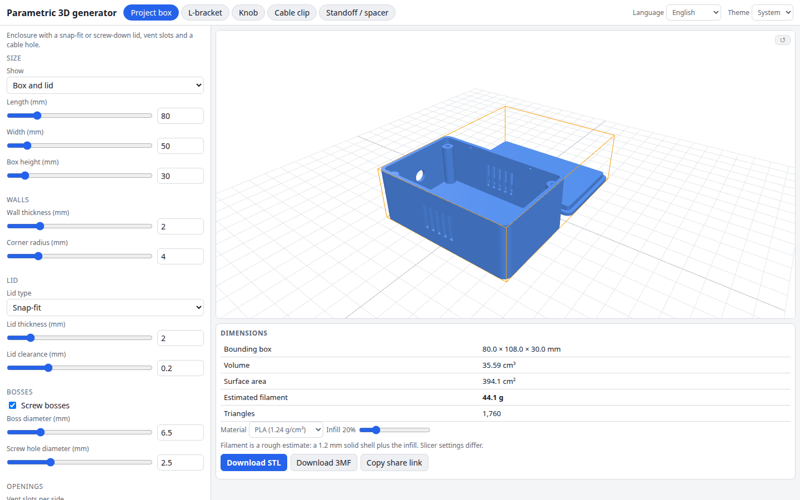

# Parametric 3D Generator

Pick a part, type in the dimensions and get a printable solid. The generator builds project boxes with lids, L-brackets, knobs, cable clips and standoffs with real CSG (the Manifold geometry kernel running as WebAssembly in a Web Worker), shows them in an orbitable 3D view with their size, volume and estimated filament use, and exports binary STL or 3MF. The parameters live in the URL, so you can share an exact design with a link.

**Try it: [hermes98761234.github.io/parametric-3d-generator](https://hermes98761234.github.io/parametric-3d-generator/)**

[](https://github.com/hermes98761234/parametric-3d-generator/actions/workflows/deploy.yml)



## Features

- **Project box.** Wall thickness, corner radius, screw bosses, snap-fit or screw-down lid (with countersunk holes), vent slots on both long sides and a cable hole. Print the box, the lid or both laid out side by side.
- **L-bracket.** Holes on both legs (optionally countersunk), a gusset rib and an inner fillet.
- **Knob.** D-shaft or round shaft with clearance, set-screw hole, smooth or ridged grip, and an engraved or raised pointer.
- **Cable clip** with an adjustable opening and screw holes in the flanges. **Standoff / spacer**, round or hex, with an optional hex nut trap.
- **Sliders and number inputs** for every parameter, in millimetres, with clear messages when values conflict (for example vents that do not fit on a wall).
- **3D viewer** with orbit controls, a build-plate grid, the bounding box drawn around the part, and a readout of dimensions, volume, surface area and estimated filament grams for PLA, PETG, ABS or TPU at your infill.
- **Export** to binary STL and 3MF (millimetres), and **share links** that carry the model and its parameters in the URL hash.
- **English or Ukrainian, light, dark or system theme.** Settings are remembered in the browser. Nothing is uploaded and nothing is tracked.

## How it works

Each model is a pure function from a flat parameter record to a Manifold solid (`src/lib/models.ts`): extruded rounded rectangles, cylinders and cones combined with union, difference and intersection. Manifold guarantees a watertight, manifold mesh, which is exactly what slicers need. Every intermediate solid is freed after each build, and the finished mesh is moved to sit on the build plate at the origin.

The CSG runs in `src/model.worker.ts`. The UI debounces changes, drops stale results and keeps showing the last good mesh while a new one builds. The `.wasm` file is loaded with Vite's `?url` import, so it is emitted as a normal asset and resolves correctly under a GitHub Pages sub-path. The single-threaded build is used, so no special COOP/COEP headers are needed.

Volume, area and bounding box are computed from the mesh itself (signed tetrahedra), which is also what the STL writer and its tests check. Filament is estimated as a solid 1.2 mm shell (surface area times shell thickness, capped at the volume) plus the infill fraction of the rest, times the material density. Treat it as a rough guide; slicers differ.

Parameters are validated individually (range, integer) and then with per-model cross-checks. The URL hash lists only values that differ from the defaults, and anything read from a link is clamped to range.

## Quick start

You need [Node.js](https://nodejs.org/) 22.

```bash
git clone https://github.com/hermes98761234/parametric-3d-generator.git
cd parametric-3d-generator
npm install
npm run dev       # http://localhost:5173
npm test          # STL/3MF writers, validation, URL hash, i18n, and Manifold CSG in Node
npm run lint
npm run build     # static site in dist/
```

## License

MIT
